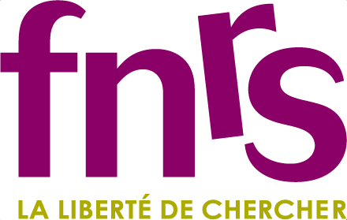

## We are hiring: postdoc and PhD positions

  
<strong>We are looking for a postdoctoral researcher and a PhD student to join the Chini Lab at GIGA–ULiège, ideally starting in March 2027!</strong>

  
Our lab has received funding as part of a new European research consortium investigating how exposure to nanoplastics during pregnancy may affect early brain development. Together with our collaborators, we will study the consequences for the formation and maturation of neuronal circuits, combining approaches ranging from animal models to human brain organoids. More details about the consortium will be shared following the official announcement.

  
<strong>Two positions are available:</strong> a 2-year postdoctoral position and a fully funded 4-year PhD position.

  
Enthusiasm, intellectual curiosity, independence, and a genuine interest in developmental neuroscience matter most. We welcome candidates from different backgrounds who are excited by the questions behind the project.

  
Interested? Email <a href="mailto:mchini@uliege.be">mchini@uliege.be</a> with your CV and a brief message explaining why you would like to join us. A formal cover letter is not necessary at this stage.

  

    <a class="postdoc-btn postdoc-btn-primary" href="mailto:mchini@uliege.be?subject=Postdoctoral%20position%20%E2%80%94%20Early%20brain%20development">Postdoc: get in touch →</a>
    <a class="postdoc-btn postdoc-btn-secondary" href="mailto:mchini@uliege.be?subject=PhD%20position%20%E2%80%94%20Early%20brain%20development">PhD: get in touch →</a>
  

## Spontaneous applications

We also welcome spontaneous applications from enthusiastic scientists at any stage: master's students, PhD students, or postdocs.
If you are driven by curiosity and want to work at the intersection of developmental biology, systems and computational neuroscience,
you are encouraged to get in touch. All backgrounds, from biology and medicine to physics and mathematics, are welcome.

If you are interested, please send a short message explaining why you would like to join the lab, along with a brief CV.
You can contact me via email or on socials — details are [here](/contact/).

  
  

